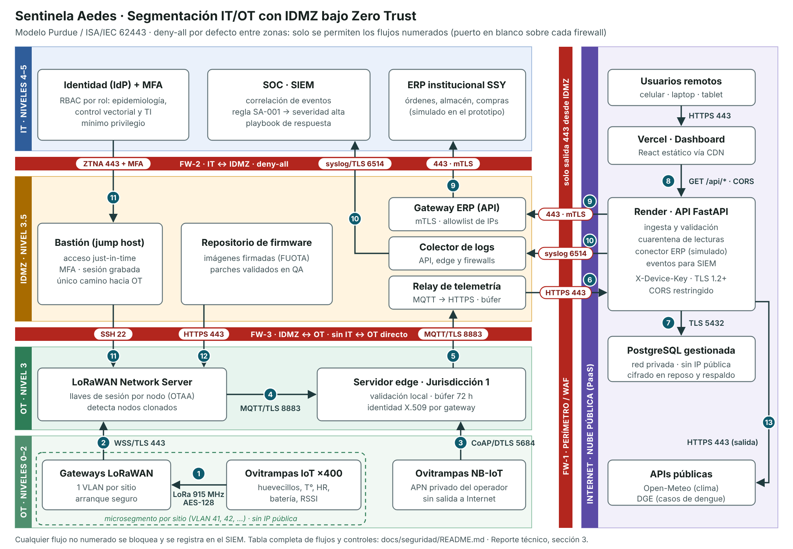

# Ciberseguridad IT/OT · Sentinela Aedes



Fuente editable: [`idmz_zero_trust.svg`](idmz_zero_trust.svg) · Regla SIEM: [`SA-001.sigma.yml`](SA-001.sigma.yml)

## Zonas (modelo Purdue / ISA/IEC 62443)

| Zona | Activos | Regla de frontera |
|---|---|---|
| OT niveles 0–2 | Ovitrampas LoRaWAN y NB-IoT, gateways LoRaWAN | Un microsegmento (VLAN) por sitio. Sin IP pública. NB-IoT solo por APN privado. |
| OT nivel 3 | LoRaWAN Network Server, servidor edge de la Jurisdicción 1 | Solo inicia conexiones hacia la IDMZ. Nada entra desde IT. |
| IDMZ nivel 3.5 | Relay de telemetría, gateway ERP, colector de logs, bastión, repositorio de firmware | Es el único punto de contacto entre OT, IT y la nube. Ningún flujo cruza de IT a OT sin terminar aquí. |
| IT niveles 4–5 | ERP de la SSY, SOC/SIEM, IdP con MFA | Solo recibe desde la IDMZ por puertos explícitos. |
| Nube pública (PaaS) | API FastAPI y PostgreSQL en Render, dashboard en Vercel | HTTPS 443 únicamente. La base no tiene IP pública. |

## Flujos permitidos (todo lo demás: deny-all y registro en el SIEM)

| # | Origen → destino | Protocolo / puerto | Control Zero Trust |
|---|---|---|---|
| 1 | Ovitrampa → gateway | LoRaWAN 915 MHz | Cifrado AES-128 de extremo a extremo, llaves de sesión por nodo (OTAA) |
| 2 | Gateway → Network Server | Basics Station WSS/TLS 443 | Certificado por gateway |
| 3 | Ovitrampa NB-IoT → edge | CoAP/DTLS 5684 | APN privado, PSK por dispositivo |
| 4 | Network Server → edge | MQTT/TLS 8883 | Tópicos restringidos por ACL |
| 5 | Edge → relay IDMZ | MQTT/TLS 8883 | Conexión iniciada siempre desde OT (sin puertos entrantes en OT) |
| 6 | Relay → API en la nube | HTTPS 443 `POST /api/telemetry` | `X-Device-Key` validada en cada petición, validación de rangos, cuarentena, regla SA-001 |
| 7 | API → PostgreSQL | TLS 5432 | Red privada del proveedor, usuario de base con mínimo privilegio |
| 8 | Usuarios → dashboard → API | HTTPS 443 `GET /api/*` | TLS, CORS restringido al dominio de Vercel |
| 9 | API → gateway ERP → ERP | HTTPS 443 con mTLS | Allowlist de IPs de salida del PaaS. El ERP nunca se expone a Internet. |
| 10 | API/edge/FW → colector → SIEM | syslog/TLS 6514 | Logs inmutables, fuente de la regla SA-001 |
| 11 | Técnico → bastión → Network Server/edge | ZTNA 443 + MFA, después SSH 22 | Acceso just-in-time, sesión grabada, sin acceso directo de IT a OT |
| 12 | Repositorio → Network Server (FUOTA) | HTTPS 443 | Firmware firmado, la firma se verifica en el nodo |
| 13 | API → Open-Meteo / DGE | HTTPS 443 de salida | Solo salida, a dominios conocidos |

## Principios Zero Trust aplicados

- **Verificar siempre.** Cada lectura se autentica (`X-Device-Key`) y se valida (rangos físicos, marca de tiempo, histórico del nodo). Ver `backend/app/telemetry.py`.
- **Mínimo privilegio.** La llave de dispositivo solo permite publicar telemetría. La base de datos solo es accesible desde la API. Los técnicos entran por el bastión con MFA y por tiempo limitado.
- **Asumir brecha.** Las lecturas sospechosas no se descartan: van a cuarentena (`quarantined_readings`) para análisis forense. Los intentos fallidos alimentan al SIEM.
- **Microsegmentación.** Hay una VLAN por sitio de campo. Si se compromete un gateway, el daño no se propaga a otros sitios.

**Alcance del prototipo:** usa una sola llave compartida (`DEVICE_API_KEY`). En producción cada gateway tendría identidad propia (certificado X.509 / mTLS), y la llave se podría revocar por dispositivo.

## Regla SIEM SA-001 (implementada y demostrable)

| Campo | Valor |
|---|---|
| Amenaza | Fuerza bruta de la llave de dispositivo (MITRE ATT&CK T1110) para inyectar conteos falsos (ATT&CK for ICS T0856) |
| Fuente de logs | `security_events` de la API (kind `auth_fail`, `source_ip`, `ts`) / stdout de uvicorn en Render |
| Condición | `kind = auth_fail` agrupado por `source_ip` |
| Umbral | 5 o más eventos en 60 s |
| Severidad | Alta |
| Acción automática | Evento `brute_force` de severidad alta, aviso `[SIEM]` en el log y visible en el tablero (Operación e integración) |
| Acción manual (playbook) | Bloquear la IP 30 min en el WAF si es externa. Si la IP es de un gateway propio, rotar la llave y revisar el equipo. Revisar la cuarentena de esa ventana. |

Demostración en vivo:

```bash
python backend/scripts/node_simulator.py --url https://<api>.onrender.com --ataque
curl https://<api>.onrender.com/api/security/events
```
